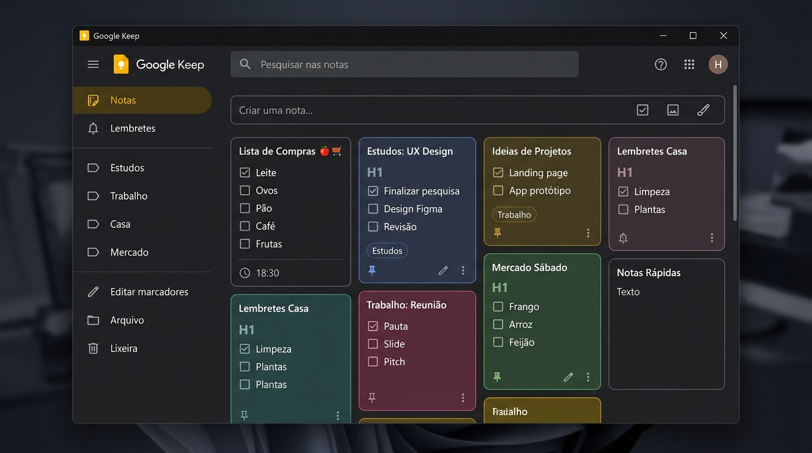
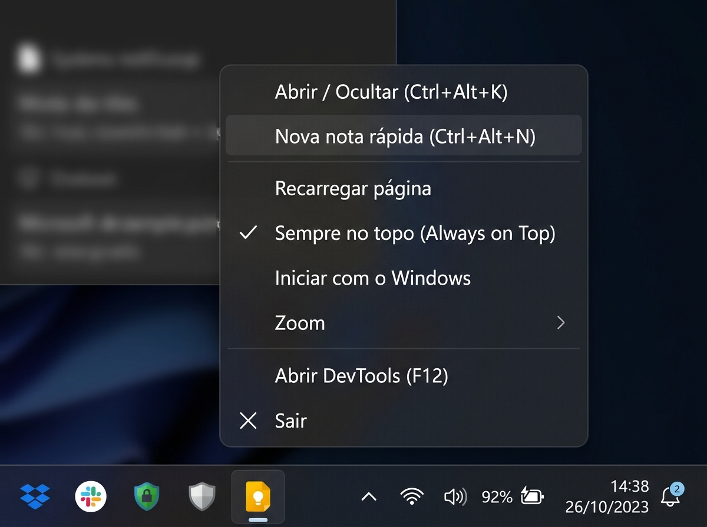

<div align="center">


# Google Keep Desktop

**Aplicativo desktop leve e nativo para o Google Keep (Windows & Linux), construído com Rust, Tauri v2, WebView2 e WebKitGTK.**

[](https://github.com/Kyouz2148/Keep-Desktop/releases)


<br />



</div>

---

## Por que este projeto foi feito?

O Google Keep não possui um aplicativo desktop oficial para Windows — a única opção padrão é mantê-lo aberto em uma aba do navegador ou como atalho simples de navegador. Isso traz alguns incômodos no dia a dia:

- **Fica perdido entre dezenas de abas** e consome memória de uma instância extra do navegador.
- **Não integra com o sistema operacional**: não há ícone na bandeja do sistema (*System Tray*), atalho global para anotar de qualquer tela, nem opção de *Sempre no topo* (*Always on Top*).
- **Fluxo lento para anotações rápidas**: abrir o navegador, achar a aba certa e clicar no campo de nota quebra o raciocínio durante o trabalho.

O objetivo do **Google Keep Desktop** é oferecer uma janela dedicada, discreta, com inicialização rápida usando o próprio motor **WebView2** já instalado no Windows (sem empacotar um Chromium inteiro como no Electron) e recursos pensados para uso contínuo em desktop.

---

## Recursos atuais (`v0.2.4`)

<div align="center">
  
</div>

<br />

- **Bandeja do sistema (System Tray)**:
  - Clique esquerdo no ícone alterna entre mostrar e ocultar a janela.
  - Fechar no `X` apenas oculta o app na bandeja, mantendo sua sessão do Google ativa e abertura instantânea.
- **Atalho global de nota rápida (`Ctrl + K`)**:
  - `Ctrl + K` — Abre **apenas uma mini-janela flutuante** (com cantos arredondados nativos no Windows 11, arrastável pelo cabeçalho) sem abrir a janela principal do Keep.
  - Suporta **seletor de cor** (paleta oficial Keep), **modo checklist** interativo, **fixar no topo**, **marcadores (`#tag`)**, **recuperação de rascunho** caso fechada com `Esc`, auto-expansão de altura e feedback visual de envio (`Ctrl + Enter` salva, `Esc` fecha).
- **Personalização visual e filtros na janela principal (submenu *Aparência*)**:
  - **Temas**: *Padrão Keep*, *AMOLED (Preto puro)*, *Nord Escuro* e *Catppuccin Mocha*.
  - **Scrollbars escuras e finas** nativas e **Modo Compacto / Foco** (oculta atalhos web extras do Google e recolhe a barra lateral em janelas estreitas).
  - **Barra flutuante de filtros rápidos**: filtre notas visíveis por *Fixadas*, *Listas*, *Pendentes*, texto ou `#tags`, escolhendo entre *Destacar* ou *Isolar*.
- **Iniciar com o sistema**:
  - Alternável pelo menu da bandeja (`HKCU\Software\Microsoft\Windows\CurrentVersion\Run` no Windows ou `~/.config/autostart/` no Linux), iniciando minimizado na bandeja (`--minimized`).
- **Sempre no topo (*Always on Top*)**:
  - Mantém o Keep flutuando sobre outros aplicativos quando necessário.
- **Persistência automática (`desktop-config.json`)**:
  - Lembra tamanho, posição (validada nos monitores conectados), tema, modo compacto, barra de filtros, estado de *Sempre no topo*, autostart e nível de zoom.
- **Controle de zoom persistente**:
  - Ajuste direto com `Ctrl + +`, `Ctrl + -`, `Ctrl + 0`, `Ctrl + Scroll do mouse` ou pelo submenu **Zoom** na bandeja (`+10%`, `-10%`, `Restaurar 100%`), salvo e reaplicado automaticamente.
- **Links externos no navegador padrão**:
  - Links clicados dentro das notas (inclusive redirecionamentos `google.com/url?q=...`) abrem no seu navegador padrão (`ShellExecuteW` no Windows / `xdg-open` no Linux), mantendo dentro do app apenas o Google Keep e telas de autenticação Google.
- **Barra de título escura nativa e DevTools integrado**:
  - Tema escuro na moldura e acesso rápido ao DevTools pelo menu da bandeja (*Abrir DevTools (F12)*).

---

## Como foi feito (Arquitetura e Soluções Técnicas)

### Stack utilizada

- **Rust + Tauri v2 (`tauri`)**: gerencia ciclo de vida da aplicação, janela nativa, bandeja do sistema (*System Tray*), atalho global (`tauri-plugin-global-shortcut`) e empacotamento (NSIS no Windows; `.deb` e `.flatpak` no Linux).
- **WebView pura com `wry` (`WebView2` / `WebKitGTK`)**: renderiza diretamente `https://keep.google.com` sem injetar `window.ipc` na página do Google Keep, além de manter uma mini-janela isolada para captura rápida de notas em `Ctrl + K`.
- **APIs Win32 / GTK**: controle fino de perfil/privacidade e zoom no WebView2/WebKitGTK, abertura de URLs externas e gerenciamento do autostart no sistema.

### O principal desafio técnico (e por que a arquitetura é assim)

Ao tentar carregar o Google Keep dentro de uma `WebviewWindow` padrão do Tauri, ocorreram duas falhas críticas que impediam o carregamento das notas após o login:

1. **Colisão com `window.ipc` no bundle minificado do Google Keep**:
   - O runtime padrão do Tauri injeta `Object.defineProperty(window, 'ipc', { value: Object.freeze(...) })` antes de a página executar.
   - O JavaScript minificado pelo *Closure Compiler* do Google Keep (`m=n`) declara uma variável minificada com o nome `ipc` e tenta definir propriedades nela (`C(ipc, Base)`), disparando `TypeError: Cannot set properties of undefined (setting 'constructor')` e abortando toda a inicialização (`initNotesApp`, `__gapiOnLoad`).
2. **Travamento de Service Worker no WebView2 (`WebView2Feedback#5764`)**:
   - Os filtros `WebResourceRequested` registrados por protocolos customizados (`tauri://`, `ipc://`) faziam o Service Worker do Keep com `InstallEvent.addRoutes` travar no estado `STARTING`, deixando o corpo da página em branco.

**Como resolvemos em [`src-tauri/src/main.rs`](src-tauri/src/main.rs):**
- Em vez de declarar janelas em `tauri.conf.json`, a janela nativa é criada diretamente com `tauri::Window::builder` (feature `unstable` do Tauri v2) sem `WebviewWindow`.
- Sobre a janela principal, anexamos uma instância pura de `wry::WebViewBuilder` (sem `ipc_handler` e sem `custom_protocol`), armazenada em `thread_local!` na thread principal.
- Antes de navegar para `https://keep.google.com`, configuramos o perfil do WebView2 no Windows com `COREWEBVIEW2_TRACKING_PREVENTION_LEVEL_NONE`, passamos flags de compatibilidade (`--disable-features=...ServiceWorkerStaticRouter,ThirdPartyStoragePartitioning,TrackingProtection3pcd`) e limpamos Service Workers antigos sem apagar cookies/autenticação.
- A mini-janela de nota rápida (`Ctrl + K`) roda em uma segunda janela/WebView isolada com UI própria e envia título/conteúdo via IPC para o backend Rust, que injeta a nota silenciosamente na WebView oculta do Keep via `evaluate_script` dentro de uma IIFE isolada, sem abrir a janela principal.

---

## Estrutura do repositório

```text
├── .github/workflows/
│   └── build-windows.yml   # CI/CD no GitHub Actions (compila Windows + Linux .deb/.flatpak)
├── docs/
│   ├── preview.jpg         # Captura ilustrativa da janela principal
│   └── tray-menu.jpg       # Captura ilustrativa do menu na bandeja do sistema
├── packaging/flatpak/
│   ├── com.kyouztech.keepdesktop.yml          # Manifesto Flatpak (GNOME Platform 49)
│   ├── com.kyouztech.keepdesktop.desktop      # Atalho Desktop XDG
│   └── com.kyouztech.keepdesktop.metainfo.xml # Metadados AppStream
├── src/
│   └── index.html          # Fallback estático mínimo exigido pelo frontendDist do Tauri
├── src-tauri/
│   ├── Cargo.toml          # Dependências Rust (tauri v2, wry, gtk/webkit2gtk, webview2-com)
│   ├── tauri.conf.json     # Metadados do app, ícone e configuração dos instaladores
│   ├── capabilities/       # Permissões padrão do Tauri
│   └── src/main.rs         # Código principal: janela, WebView, tray, atalhos, config e links
└── README.md
```

---

## Instalação

Baixe os pacotes da versão mais recente na página de **[Releases](https://github.com/Kyouz2148/Keep-Desktop/releases)**:

### Windows
- **Instalador completo**: `Google.Keep_<versao>_x64-setup.exe`
- **Executável avulso**: `keep-desktop.exe`

*(Requer o Microsoft Edge WebView2 Runtime, já pré-instalado no Windows 10/11.)*

### Linux (`.deb` — Debian / Ubuntu / Mint / Pop!\_OS)
```bash
sudo apt install ./Google.Keep_<versao>_amd64.deb
```

### Linux (`Flatpak` — qualquer distro)
```bash
flatpak install --user ./Google.Keep_<versao>_x86_64.flatpak
flatpak run com.kyouztech.keepdesktop
```
*(Caso ainda não tenha o runtime GNOME 49 configurado no Flathub: `flatpak remote-add --if-not-exists flathub https://dl.flathub.org/repo/flathub.flatpakrepo`.)*

---

## Compilação local e CI/CD

### Localmente

```bash
npm install -g @tauri-apps/cli@^2
cargo tauri dev    # Executar em modo desenvolvimento
cargo tauri build  # Gerar binário e pacote nativo (NSIS no Windows / .deb no Linux)
```

### Automação via GitHub Actions

Todo `push` na branch `main` (ou tag `v*`) executa o workflow [`.github/workflows/build-windows.yml`](.github/workflows/build-windows.yml) em `windows-latest` e `ubuntu-latest`, gerando simultaneamente o instalador Windows (NSIS + `.exe`), o pacote `.deb` e o bundle `.flatpak` na Release correspondente à versão definida em [`src-tauri/tauri.conf.json`](src-tauri/tauri.conf.json).
